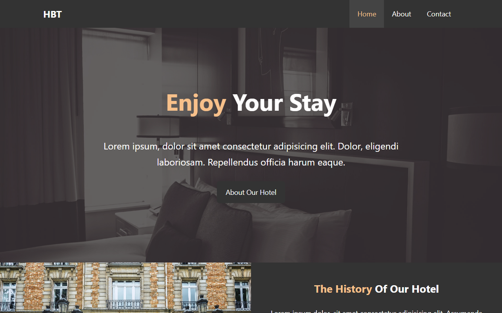
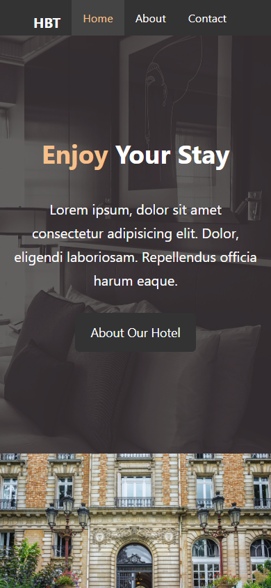

# Hotel BT: Hotel Website

A three-page static website for a fictional hotel: home, about and contact.

**Live site:** https://smadhu6364-beep.github.io/hotel_website/

Built by following Traversy Media's "Hotel BT" HTML/CSS tutorial, as practice in page layout and multi-page navigation. The layout has since been moved from floats to flexbox and grid.

## Pages
- `index.html`: home and showcase
- `about.html`: about the hotel and guest testimonials
- `contact.html`: contact form (demo only, nothing is sent)

## What's in it
- Flexbox and grid layout that works from phone to desktop
- Fluid type with `clamp()`, sticky navigation
- Dark mode via `prefers-color-scheme`
- Semantic landmarks, alt text, labelled form fields, visible focus styles

## Tech stack
HTML5, CSS3, Font Awesome 6. No build step.

## Run locally
Open `index.html` in a browser, or run `python -m http.server 8000` in the folder.

## Deployment
Every push to `master` deploys to GitHub Pages through `.github/workflows/pages.yml`.
